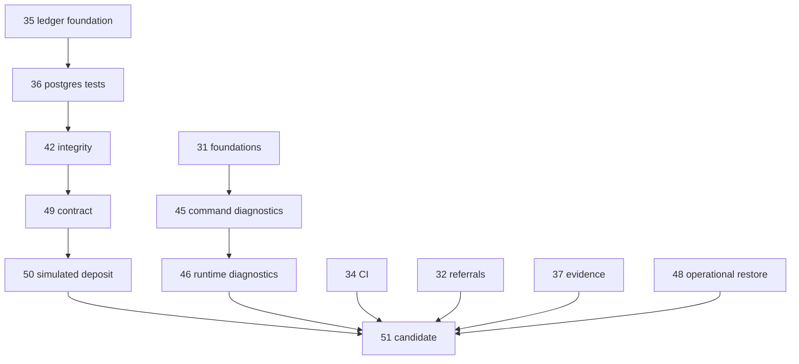

# PROFINO engineering baseline · 2026-11-13

## Snapshot and boundaries

Default branch [main at aeefcc9f](https://github.com/mahdialimohammadi097-sudo/telegram-starter-bot/tree/aeefcc9f2b94e54f164b9e3af89ff7e10a10b89f); integration [#51 at 08db454c](https://github.com/mahdialimohammadi097-sudo/telegram-starter-bot/tree/08db454c542a85a9f88713bd314b24e1edb8bf09), targeting #50. GitHub returned 54 branch refs, 51 PRs, 17 open (16 drafts), 30 merged and 4 closed without merge. Default-branch push [validation](https://github.com/mahdialimohammadi097-sudo/telegram-starter-bot/actions/runs/42911219237); candidate [validation](https://github.com/mahdialimohammadi097-sudo/telegram-starter-bot/actions/runs/43400443001). Recent development spans audit-write fixtures (08db454c, 25af442f), atomic audit recording (ebd4541e), membership revocation locking (79d59f4f), concurrent confirmations (4d0004e1) and versioned status confirmation (5bd247ca). Host settings, live schema and delivery were not accessed.

## Implementation baseline

| Classification | Evidence and consequence |
| --- | --- |
| Merged | #1–#29 and #33 include scheduled posts, history, private access, account status checks, rate limiting, schema diagnostics, admin tooling, health monitoring and exact-unit helpers. Verify current implementations in main's `index.js`, `src/commands.js`, `src/admin-ops.js`, `src/health-http.js`, `src/ledger-safety.js`; historical merges do not establish live behavior. |
| Implemented on review branches | #51 has offline registration, wallet history, scoped receipts, synthetic deposit approvals, withdrawal holds, reviewer releases, settlement and reconciliation. See `src/ledger-posting.postgres.test.js`, `src/wallet-balances.js`, `test-support/`. Production entry registers commands without injecting financial writers. |
| Partial | Invite links and repair in `src/referral-link.js` and `src/registration.postgres.test.js`. Private language preference, audit and access have integration coverage; full localization and Telegram delivery acceptance are outstanding. |
| Planned | Real custody, deposit observation, payout delivery, referral attribution and rewards. Network/token and address checks in `test-support/bsc-testnet-receipt.js` use a captured fixture. Central address rotation, actual wallet assignment and external settlement have no verified production workflow here. |
| Unverified | Target DDL/functions, constrained DB role, FadeHost network/TLS, recovery from representative backup, live Telegram/channel delivery and deployment provenance. A passing synthetic matrix establishes none of these. |
| Confirmed defects | Both inspected entry points permitted missing webhook secret. Candidate HTTP route returned an async webhook promise without handling rejection. Under webhook mode an unconfigured secret allowed requests with no token; malformed JSON could reject outside request handling. This branch adds offline regression coverage and validates configuration before startup side effects. Actual host exposure unknown. |

## PR inventory and dependency graph

Edges show dependency or inclusion; #35's two later docs commits are outside the original integration head. #48 is integrated by this change. All 17 open PRs reported clean relative to their declared bases at audit time; stacked mergeability does not prove arbitrary cross-branch compatibility. The CI column is the latest workflow reported for that exact head. No release or approval is implied.

| PR | Base → head | Head | CI | Relation to initial #51 | Consequence / action |
| --- | --- | --- | --- | --- | --- |
| [#51](https://github.com/mahdialimohammadi097-sudo/telegram-starter-bot/pull/51) draft | `feature/simulated-deposit-wallet` → `feature/integrated-postgres-matrix` | `08db454c` | [success](https://github.com/mahdialimohammadi097-sudo/telegram-starter-bot/actions/runs/43400443001) | included | Integration tip; base is #50. Review the combined diff against main before release. |
| [#50](https://github.com/mahdialimohammadi097-sudo/telegram-starter-bot/pull/50) draft | `feature/ledger-production-contract` → `feature/simulated-deposit-wallet` | `4c5f526b` | [success](https://github.com/mahdialimohammadi097-sudo/telegram-starter-bot/actions/runs/43070424753) | included | Synthetic deposit and wallet; follows #49. Reconcile independently and keep writers offline. |
| [#49](https://github.com/mahdialimohammadi097-sudo/telegram-starter-bot/pull/49) draft | `feature/ledger-posting-integrity-tests` → `feature/ledger-production-contract` | `540217b3` | [success](https://github.com/mahdialimohammadi097-sudo/telegram-starter-bot/actions/runs/43069000827) | included | Ledger contract fixture follows #42. Compare deferred constraints and trigger bodies to target DDL. |
| [#48](https://github.com/mahdialimohammadi097-sudo/telegram-starter-bot/pull/48) draft | `main` → `infra/postgres17-restore-drill` | `271ad58e` | [success](https://github.com/mahdialimohammadi097-sudo/telegram-starter-bot/actions/runs/43088370777) | diverged | Standalone five-table synthetic restore. Integrate as a second parent and execute on the combined tree. |
| [#47](https://github.com/mahdialimohammadi097-sudo/telegram-starter-bot/pull/47) draft | `main` → `verify/profino-telegram-access` | `600640b9` | [success](https://github.com/mahdialimohammadi097-sudo/telegram-starter-bot/actions/runs/43065676789) | diverged | Manual Telegram capability workflow; separate from candidate. Live bot/channel access requires an authorized operator. |
| [#46](https://github.com/mahdialimohammadi097-sudo/telegram-starter-bot/pull/46) draft | `feature/security-error-logs-after-financial-audit` → `feature/security-startup-diagnostics-after-audit` | `00ba263e` | [success](https://github.com/mahdialimohammadi097-sudo/telegram-starter-bot/actions/runs/42984646202) | included | Runtime diagnostic redaction on #45. Review shutdown and startup exceptions. |
| [#45](https://github.com/mahdialimohammadi097-sudo/telegram-starter-bot/pull/45) draft | `feature/phase2-financial-foundation-clean` → `feature/security-error-logs-after-financial-audit` | `7f7830a2` | [success](https://github.com/mahdialimohammadi097-sudo/telegram-starter-bot/actions/runs/42984619694) | included | Command diagnostic redaction on #31. Retain safe-code paths when resolving conflicts. |
| [#43](https://github.com/mahdialimohammadi097-sudo/telegram-starter-bot/pull/43) draft | `main` → `docs/add-database-url-env-example` | `d1c03fc3` | [success](https://github.com/mahdialimohammadi097-sudo/telegram-starter-bot/actions/runs/42983527063) | diverged | Environment example differs. Compare key names without copying values or overwriting candidate documentation. |
| [#42](https://github.com/mahdialimohammadi097-sudo/telegram-starter-bot/pull/42) draft | `feature/ledger-posting-postgres17-tests` → `feature/ledger-posting-integrity-tests` | `7d1b21c7` | [success](https://github.com/mahdialimohammadi097-sudo/telegram-starter-bot/actions/runs/42981361057) | included | Integrity regression on #36. Keep immutable posted rows and deferred commit checks. |
| [#39](https://github.com/mahdialimohammadi097-sudo/telegram-starter-bot/pull/39) draft | `main` → `security/sanitize-startup-diagnostic-code` | `0ebd616b` | [success](https://github.com/mahdialimohammadi097-sudo/telegram-starter-bot/actions/runs/43039532837) | diverged | Startup diagnostic redaction overlaps candidate health-report code. Compare behavior and tests before incorporating residual changes. |
| [#38](https://github.com/mahdialimohammadi097-sudo/telegram-starter-bot/pull/38) draft | `main` → `audit/database-connection-security-review` | `b5361b21` | [success](https://github.com/mahdialimohammadi097-sudo/telegram-starter-bot/actions/runs/42925752887) | diverged | Separate TLS audit document. Verify FadeHost network and TLS trust chain before changing connection behavior. |
| [#37](https://github.com/mahdialimohammadi097-sudo/telegram-starter-bot/pull/37) draft | `main` → `docs/ledger-audit-postgres17-evidence-20261111` | `0d599d9b` | [success](https://github.com/mahdialimohammadi097-sudo/telegram-starter-bot/actions/runs/43088573999) | included | Historical ledger evidence already present in integration ancestry. Preserve dated findings as history. |
| [#36](https://github.com/mahdialimohammadi097-sudo/telegram-starter-bot/pull/36) draft | `feature/ledger-posting-foundation` → `feature/ledger-posting-postgres17-tests` | `6dcf38e8` | [success](https://github.com/mahdialimohammadi097-sudo/telegram-starter-bot/actions/runs/42975463597) | included | Based on ledger foundation. Current #35 tip has two later documentation commits; integrate the code ancestry first. |
| [#35](https://github.com/mahdialimohammadi097-sudo/telegram-starter-bot/pull/35) draft | `main` → `feature/ledger-posting-foundation` | `677b58a7` | [success](https://github.com/mahdialimohammadi097-sudo/telegram-starter-bot/actions/runs/42976734510) | diverged | Two commits unique relative to #51 only change audit documentation. Review those deltas without replacing newer ledger code. |
| [#34](https://github.com/mahdialimohammadi097-sudo/telegram-starter-bot/pull/34) open | `main` → `feature/profino-ci-node20-matrix` | `0623d461` | [success](https://github.com/mahdialimohammadi097-sudo/telegram-starter-bot/actions/runs/42976542716) | included | CI matrix, not a financial feature. Included; do not apply workflow changes twice. |
| [#32](https://github.com/mahdialimohammadi097-sudo/telegram-starter-bot/pull/32) draft | `main` → `feature/referral-invite-link-foundation` | `a4293a94` | [success](https://github.com/mahdialimohammadi097-sudo/telegram-starter-bot/actions/runs/42975130905) | included | Invite display and code formatting included. Attribution and rewards outside implemented flow. |
| [#31](https://github.com/mahdialimohammadi097-sudo/telegram-starter-bot/pull/31) draft | `main` → `feature/phase2-financial-foundation-clean` | `8abe1904` | [success](https://github.com/mahdialimohammadi097-sudo/telegram-starter-bot/actions/runs/42984484941) | included | Financial foundation; diagnostics, status transitions and exact amounts. Included through #45/#46. |

### Changed files for open PRs

- **#51** `.github/workflows/validate.yml`, `docs/financial-ledger-audit.md`, `docs/financial-product-implementation-plan.md`, `docs/implementation-status.md`, `docs/phase1-production-audit.md`, `index.js`, `package.json`, `scripts/check-wallet-restore.js`, `src/admin-language.js`, `src/admin-language.postgres.test.js`, `src/admin-ops.js`, `src/admin-status.postgres.test.js`, `src/commands.js`, `src/database-diagnostics.js`, `src/database-diagnostics.postgres.test.js`, `src/database-diagnostics.test.js`, `src/diagnostic-safety.js`, `src/diagnostic-safety.test.js`, `src/ledger-posting.postgres.test.js`, `src/ledger-safety.test.js`, `src/plan-preview.js`, `src/plan-preview.test.js`, `src/post-history.js`, `src/post-management.js`, `src/post-schedule.js`, `src/post-schedule.test.js`, `src/referral-link.js`, `src/referral-link.test.js`, `src/registration.postgres.test.js`, `src/scheduler.js`, `src/testnet-receipt.test.js`, `src/transaction-safety.js`, `src/transaction-safety.test.js`, `src/wallet-balances.js`, `test-support/bsc-testnet-receipt.js`, `test-support/reconcile-simulated-deposits.js`, `test-support/reconcile-simulated-settlements.js`, `test-support/reconcile-simulated-withdrawals.js`, `test-support/simulated-investment.js`, `test-support/simulated-withdrawal.js`, `test-support/withdrawal-schema.js`, `test/fixtures/bsc-testnet-transfer.json`.
- **#50** `src/commands.js`, `src/ledger-posting.js`, `src/ledger-posting.postgres.test.js`, `src/wallet-balances.js`.
- **#49** `src/ledger-posting.js`, `src/ledger-posting.postgres.test.js`, `test/fixtures/ledger-contract.sql`.
- **#48** `.github/workflows/postgres-restore.yml`, `scripts/test-postgres-restore.sh`.
- **#47** `.github/workflows/telegram-access.yml`.
- **#46** `index.js`.
- **#45** `src/commands.js`, `src/post-history.js`, `src/post-management.js`, `src/scheduler.js`.
- **#43** `.env.example`.
- **#42** `src/ledger-posting.postgres.test.js`.
- **#39** `src/health-report.js`, `src/health-report.test.js`.
- **#38** `docs/database-connection-security-review.md`.
- **#37** `docs/financial-ledger-audit.md`, `docs/implementation-status.md`.
- **#36** `.github/workflows/validate.yml`, `package.json`, `src/ledger-posting.postgres.test.js`.
- **#35** `docs/financial-ledger-audit.md`, `docs/ledger-posting-foundation.md`, `src/ledger-posting.js`, `src/ledger-posting.test.js`.
- **#34** `.github/workflows/validate.yml`.
- **#32** `docs/implementation-status.md`, `src/commands.js`, `src/referral-link.js`, `src/referral-link.test.js`.
- **#31** `.github/workflows/validate.yml`, `docs/financial-ledger-audit.md`, `docs/financial-product-implementation-plan.md`, `docs/implementation-status.md`, `docs/phase1-production-audit.md`, `src/admin-ops.js`, `src/commands.js`, `src/database-diagnostics.js`, `src/database-diagnostics.postgres.test.js`, `src/database-diagnostics.test.js`, `src/diagnostic-safety.js`, `src/diagnostic-safety.test.js`, `src/ledger-safety.test.js`, `src/transaction-safety.js`, `src/transaction-safety.test.js`.

### Closed and merged inventory

| PR | State | Change |
| --- | --- | --- |
| [#44](https://github.com/mahdialimohammadi097-sudo/telegram-starter-bot/pull/44) | closed, unmerged | security: sanitize startup and runtime error diagnostics |
| [#41](https://github.com/mahdialimohammadi097-sudo/telegram-starter-bot/pull/41) | closed, unmerged | PROFINO: test deferred ledger failures and posted-entry immutability |
| [#40](https://github.com/mahdialimohammadi097-sudo/telegram-starter-bot/pull/40) | closed, unmerged | PROFINO: sanitize command-layer error diagnostics |
| [#33](https://github.com/mahdialimohammadi097-sudo/telegram-starter-bot/pull/33) | merged | Harden external monitor Telegram delivery verification |
| [#30](https://github.com/mahdialimohammadi097-sudo/telegram-starter-bot/pull/30) | closed, unmerged | PROFINO Phase 2: financial foundations and release gates |
| [#29](https://github.com/mahdialimohammadi097-sudo/telegram-starter-bot/pull/29) | merged | PROFINO Phase 1: production audit and exact ledger precision |
| [#28](https://github.com/mahdialimohammadi097-sudo/telegram-starter-bot/pull/28) | merged | PROFINO: bind HTTP service for FadeHost |
| [#27](https://github.com/mahdialimohammadi097-sudo/telegram-starter-bot/pull/27) | merged | PROFINO: bilingual admin panel foundation |
| [#26](https://github.com/mahdialimohammadi097-sudo/telegram-starter-bot/pull/26) | merged | Add independent external uptime monitoring |
| [#25](https://github.com/mahdialimohammadi097-sudo/telegram-starter-bot/pull/25) | merged | Add automated Telegram and database health monitoring |
| [#24](https://github.com/mahdialimohammadi097-sudo/telegram-starter-bot/pull/24) | merged | Add automatic read-only startup health reports |
| [#23](https://github.com/mahdialimohammadi097-sudo/telegram-starter-bot/pull/23) | merged | Expand read-only database inventory and trigger diagnostics |
| [#22](https://github.com/mahdialimohammadi097-sudo/telegram-starter-bot/pull/22) | merged | Align admin user status actions with database constraints |
| [#21](https://github.com/mahdialimohammadi097-sudo/telegram-starter-bot/pull/21) | merged | Add read-only core database schema diagnostics |
| [#20](https://github.com/mahdialimohammadi097-sudo/telegram-starter-bot/pull/20) | merged | Reject stale admin user-status confirmations |
| [#19](https://github.com/mahdialimohammadi097-sudo/telegram-starter-bot/pull/19) | merged | Add private-chat rate limiting and unit tests |
| [#18](https://github.com/mahdialimohammadi097-sudo/telegram-starter-bot/pull/18) | merged | Enforce private-chat access and account status checks |
| [#17](https://github.com/mahdialimohammadi097-sudo/telegram-starter-bot/pull/17) | merged | Use USDT for admin audit currency |
| [#16](https://github.com/mahdialimohammadi097-sudo/telegram-starter-bot/pull/16) | merged | Add read-only audit currency constraint diagnostic |
| [#15](https://github.com/mahdialimohammadi097-sudo/telegram-starter-bot/pull/15) | merged | Fix admin audit foreign key and required field mapping |
| [#14](https://github.com/mahdialimohammadi097-sudo/telegram-starter-bot/pull/14) | merged | Extend admin audit diagnostic with admin membership mapping |
| [#13](https://github.com/mahdialimohammadi097-sudo/telegram-starter-bot/pull/13) | merged | Add read-only admin audit schema diagnostic |
| [#12](https://github.com/mahdialimohammadi097-sudo/telegram-starter-bot/pull/12) | merged | Support legacy admin audit user column |
| [#11](https://github.com/mahdialimohammadi097-sudo/telegram-starter-bot/pull/11) | merged | Add missing admin audit actor column |
| [#10](https://github.com/mahdialimohammadi097-sudo/telegram-starter-bot/pull/10) | merged | Expose admin audit write diagnostics |
| [#9](https://github.com/mahdialimohammadi097-sudo/telegram-starter-bot/pull/9) | merged | Audit admin dashboard and user lookup activity |
| [#8](https://github.com/mahdialimohammadi097-sudo/telegram-starter-bot/pull/8) | merged | Add admin user search |
| [#7](https://github.com/mahdialimohammadi097-sudo/telegram-starter-bot/pull/7) | merged | Enforce active account status on private interactions |
| [#6](https://github.com/mahdialimohammadi097-sudo/telegram-starter-bot/pull/6) | merged | Fix admin audit schema migration |
| [#5](https://github.com/mahdialimohammadi097-sudo/telegram-starter-bot/pull/5) | merged | Improve PROFINO activity report diagnostics |
| [#4](https://github.com/mahdialimohammadi097-sudo/telegram-starter-bot/pull/4) | merged | Make admin activity callback failures visible |
| [#3](https://github.com/mahdialimohammadi097-sudo/telegram-starter-bot/pull/3) | merged | Add bilingual PROFINO admin operations dashboard |
| [#2](https://github.com/mahdialimohammadi097-sudo/telegram-starter-bot/pull/2) | merged | Add PROFINO post history and controlled restoration |
| [#1](https://github.com/mahdialimohammadi097-sudo/telegram-starter-bot/pull/1) | merged | Add safe scheduled post management and UTC scheduling |

## Integration decision

1. Retain #51 as the isolated review line. Keep #31→#45→#46 and ledger foundation→#36→#42→#49→#50 histories. #32, #34 and #37 already occur in its ancestry.
2. Carry #48 with both parents and its original script. Run its operational recovery drill alongside the existing wallet replay on the new SHA. Do not dispatch the credentialed #47 workflow as part of candidate CI.
3. Resolve remaining branch deltas individually: #35 docs; #38 TLS findings; #39 startup redaction overlap; #43 configuration examples; #47 operator procedure. Compare exact tree and behavior before any independent PR disposition. No reason to close, rebase or merge other authors' PRs during this audit.
4. Review one aggregate candidate-to-main diff in an isolated rehearsal, resolve divergences there, rerun matrix, restores and schema compatibility checks. #51 targets a feature branch, so merging it alone cannot deliver the candidate to main. Choose a reviewed forward integration into main only after owner approval.

## Architecture and financial evidence

Locked dependencies: grammY 1.46.0, pg 8.23.1 (`package-lock.json`). Node targets are 22/24/26 on PostgreSQL 17; declared minimum Node 20. `index.js` coordinates receiver, HTTP health, scheduler and shutdown. `src/database.js` owns the pool. `src/post-management.js` and `src/post-history.js` manage publication. Startup calls schema initializers before receiver activation; legacy upgrade rehearsal and separation of deployment/runtime privileges are still required.

`src/ledger-safety.js` uses exact integer units for posting; `src/ledger-posting.js` controls transactions, locking, idempotency and rollback. The fixture `test/fixtures/ledger-contract.sql` and PG tests cover deferred commit failures, immutable posted entries, concurrent overdrafts and duplicate journal keys. Deposits, withdrawals and settlements have independent discrepancy queries in `test-support/reconcile-simulated-*.js`. Trace references and audit rows belong in the restored database as well. Independent reconciliation of a production snapshot and compensating-entry procedures remain open.

`src/plan-preview.js` defines 10/25/50/75/100 test USDT. STARTER uses 10 days/4%/2%, SMART 30/14%/4%, PRO 90/40%/6%. The shared calculation charges the fee on principal plus profit at settlement. The offline opener stores terms and maturity, serializes by owner and checks the five-active cap. No automatic compounding or production financial worker is wired in `index.js`. These figures are owner-defined simulation inputs.

## Release blockers, verification and rollback

| Gate | Required evidence and reproducible check | Responsibility |
| --- | --- | --- |
| Authentic inbound updates | Run local HTTP tests with no header, wrong header, valid header and malformed JSON. For a future webhook deployment confirm secure provisioning privately before rollout. Polling remains the default. | Engineering / host operator |
| DB compatibility and privilege | Obtain sanitized schema-only export through the operator; restore in isolated PG17; diff columns, decimal scales, unique/index definitions, FKs, trigger functions and deferred timing against fixture. Exercise startup twice, on empty and prior populated schema, then run posting/rollback/reconciliation with a least-privilege test role. | DBA / engineering |
| Custody and authorization | No chain broadcasts. Validate synthetic address/network assignment, authorization loss, event uniqueness, independent reconciliation and reversals. Require separate reserve/liquidity and legal review before enabling real flows. | Engineering / owner |
| Dependency and runtime exposure | Obtain current lockfile advisory scan and triage findings. Check Telegram receiver authentication, input size/rate limits, SQL parameterization, diagnostic redaction, outbound alert contents, private DB connectivity and TLS trust. Runtime pool explicitly sets ssl false. Test secrets handling with dummy values only. | Security / hosting |
| Operational recovery | Run five-table restore in network-isolated PG17 and wallet drill in disposable PG17. Then restore an authorized sanitized representative backup, including constraints and trigger bodies. Verify privileges, backup encryption and restricted retention. Proposed targets for owner review: RPO ≤15 min, RTO ≤60 min. Measure RPO from most recent recoverable committed record and RTO from declared incident to reconciled service readiness. | DBA / owner |
| Monitoring and delivery | In staging test /livez, /healthz, DB outage/recovery, polling exclusivity or authenticated webhook, SIGTERM/restart, external alert delivery, deduplication and recovery notice. Capture timestamps. See `docs/runtime-reliability.md` and `docs/external-uptime-monitor.md`. | Operator |
| Publication / rollback | Record current deployed SHA and backup identity. Rehearse prior-image rollback and data compatibility in staging before rollout. On failed readiness stop rollout, restore prior approved image, verify receiver uniqueness, DB invariants and reconciliation. Rehearse database restore in isolation before any production data action. | Owner / operator |

## Eight-phase evidence score

Fractions below count named engineering gates for this assessment. Each phase has equal weight here; these are the eight directive phases, distinct from historical chat estimates. Fractional scope coverage does not estimate remaining time. 100% also requires all definition-of-done conditions.

| Phase | Demonstrated gates | Outstanding gates | Score |
| --- | --- | --- | --- |
| Audit | Repository/branches/PR inventory; runtime and module inventory; fixture/test inventory | Independent target environment contract | 3/4 |
| Dependencies | Base/head graph; ancestry comparison; declared-base mergeability and CI | Combined release-to-main rehearsal | 3/4 |
| Integration | Stacked financial/CI candidate; operational restore integrated; residual branch dispositions recorded | Target migration rehearsal | 3/4 |
| Financial correctness | Exact/balanced journals; concurrency and rollback; fixture reconciliation | Target-contract verification; reversal/ledger immutability acceptance | 3/5 |
| Application | Customer registration/navigation; bilingual private admin; offline plan and transfer flows | Full Telegram acceptance; remaining agreed referral/notification scope | 3/5 |
| Security/reliability | Private access and rate limits; authenticated HTTP regression | Dependency/DB privilege review; staging outages and alert delivery | 2/4 |
| Comprehensive validation | Unit + PG matrix; concurrency/rollback; synthetic recovery | Representative migration; staging acceptance | 3/5 |
| Release preparation | Blocker register and rollback procedure | Staging rehearsal; independent financial/operational sign-off; owner release decision | 1/4 |

The weighted mean with equal phase weights is 60%. Update only when gate evidence changes. No changes to main, FadeHost, production PostgreSQL or Telegram service are required by this report.

## Reconciliation of residual branches

After the initial inventory, the disabled-by-default operator workflow from #47, TLS review from #38, environment documentation from #43, and formatter plus regression tests from #39 were integrated with their original commits as parents. Only template guidance was edited for the stricter webhook contract. #47's push trigger selects its own verification branch; the credentialed workflow was not dispatched. #35's two residual commits update historical proof in the November 11 documents (46 tests in [run 42975463597](https://github.com/mahdialimohammadi097-sudo/telegram-starter-bot/actions/runs/42975463597)). The candidate keeps its later versions of those documents and includes #35's head as a parent. This preserves later evidence while recording the disposition of both overlapping edits. All 17 open heads at the initial snapshot are now accounted for on the integration line. Existing PRs remain independently reviewable.

The operational drill runs on every push to the isolated integration branch so that the reported matrix and both recovery checks can be attached to the same commit. Runtime tests use offline bot identity and dummy input. Before release the owner must select and approve a production change set, stage the migrations and verify the host checks above.

The validation workflow also runs npm audit on the lockfile. The monitor now retains the latest undelivered status per service until a send succeeds. In the previous implementation a failed send advanced the observed state and an ongoing outage produced no retry. The regression injects an initial send failure, checks one successful retry and one recovery, and verifies diagnostic redaction. A lost delivery acknowledgement can still cause a duplicate; Telegram delivery has no exactly-once contract.

## Populated legacy schema rehearsal

The PostgreSQL 17 operational drill seeds a synthetic legacy audit table with a required admin ID and a scheduled post predating history tracking. It runs the application initializers, exercises the column list shared by the two audit writers, restores the five tables, and starts the initializers twice on the restored data. Full-row comparisons and explicit assertions cover the historical audit identity, unknown currency/metadata, the new USDT audit row and a single tracking snapshot per legacy post. The candidate initializer adds missing currency and metadata without inferring historical values. Actual target column types, permissions and prior-image rollback still require an authorized representative schema.

## Previous-code rollback and forward replay

The operational workflow checks out main revision `aeefcc9f2b94e54f164b9e3af89ff7e10a10b89f` under `rollback-reference` and compares its dependency lock before sharing installed packages. The network-isolated PG17 drill restores six synthetic tables, including the owner membership, then runs the pinned initializers and the actual private `/adminlogs` handler with an offline grammY transport. A separate candidate process reruns its initializers, reads the previous revision's event in Persian and appends its own event. Assertions check historical entries, actor, currency, JSON fields and preservation of the prior row. Host image rollback, other workflows, production-equivalent DDL and operational recovery timing remain open.

### Scheduled publication across a rollback

The restore workflow seeds three synthetic already-previewed posts. Separate candidate, pinned previous-code and candidate processes replay approval callbacks against the same restored database. Assertions count outbound calls on an offline Telegram transport and verify every post-history transition. Cases include an expired approval acknowledgement after the claim, a lost publication response, and a post first published by the previous revision. An uncertain publication stays available for manual investigation without automatic resend. This drill starts at approval and does not establish actual channel delivery.
